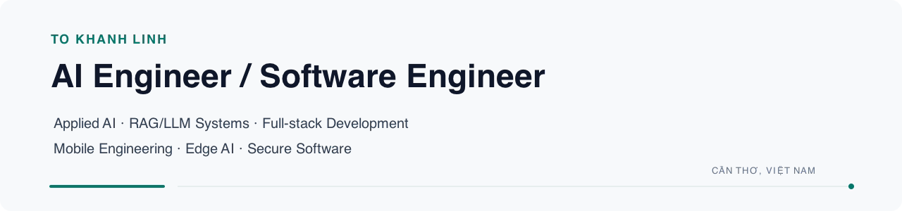

<picture>
  <source media="(prefers-color-scheme: dark) and (max-width: 600px)" srcset="./assets/profile-header-mobile-dark.png">
  <source media="(prefers-color-scheme: light) and (max-width: 600px)" srcset="./assets/profile-header-mobile-light.png">
  <source media="(prefers-color-scheme: dark)" srcset="./assets/profile-header-dark.png">
  <source media="(prefers-color-scheme: light)" srcset="./assets/profile-header-light.png">
  
</picture>

  <a href="https://khanh-linh-portfolio.vercel.app/"><strong>Portfolio</strong></a>
  &nbsp;·&nbsp;
  <a href="https://github.com/khanhlinhcode"><strong>GitHub</strong></a>
  &nbsp;·&nbsp;
  <a href="https://nlp-academic-search-api.onrender.com/docs"><strong>RAG API</strong></a>
  &nbsp;·&nbsp;
  <a href="https://fartamarket.company"><strong>Commerce demo</strong></a>

## Engineering overview

I build evidence-grounded AI applications and the software systems around them:
retrieval pipelines, APIs, web and mobile products, and edge integrations. My
work favors explicit contracts, security boundaries, reproducible tests, and
honest failure states over unsupported claims.

Computer Science Engineer based in Cần Thơ, Việt Nam, open to AI Engineering,
Mobile, and Software Engineering opportunities.

## Technical capabilities

- **AI Engineering** — Python, PyTorch, FastAPI, NLP, hybrid retrieval, vector
  search, Retrieval-Augmented Generation, semantic claim verification, and
  recommendation systems.
- **Backend & system design** — Laravel, PHP, Node.js, NestJS, TypeScript, REST
  APIs, authentication, authorization, idempotency, rate limiting, and
  transactional data integrity.
- **Frontend & mobile** — React, Next.js, TypeScript, Vite, Flutter, Dart,
  Riverpod, accessible interfaces, and client-side state management.
- **Data & infrastructure** — MySQL, PostgreSQL, MongoDB, Redis, Qdrant, Docker,
  Linux, GitHub Actions, and automated browser/API testing.
- **Edge AI & IoT** — Raspberry Pi, ESP32, MediaPipe, OpenCV, MQTT, PlatformIO,
  Firebase, and embedded C++ integration.
- **Blockchain integration** — Solidity, Hardhat, ethers.js, IPFS, QR-based
  verification, and smart-contract-backed state.

## Featured engineering projects

### [NLP Academic Search & RAG Engine](https://github.com/khanhlinhcode/NLP-Academic-Search-RAG-Engine)

Hybrid academic search and grounded question answering over research-paper
metadata. The system combines lexical and dense retrieval, streams answers over
SSE, validates citations, and maps factual claims back to retrieved evidence.

`Python` `FastAPI` `Qdrant` `BM25` `RRF` `Streamlit` ·
[API documentation](https://nlp-academic-search-api.onrender.com/docs)

**Status:** research/demo system; semantic verification reduces grounding risk
but does not guarantee factual correctness.

### Farta commerce ecosystem

A multi-client commerce system covering a Flutter customer app, React
storefront, administration portal, and server-authoritative APIs. The work
includes Sanctum authentication, capability authorization, inventory controls,
idempotent checkout, COD/SePay boundaries, and automated browser tests.

[Mobile](https://github.com/khanhlinhcode/Farta_Mobile) ·
[Storefront](https://github.com/khanhlinhcode/Farta_Market) ·
[Laravel API](https://github.com/khanhlinhcode/BE_Farta-Market-) ·
[TypeScript system](https://github.com/khanhlinhcode/farta-commerce) ·
[Demo](https://fartamarket.company)

`Flutter` `React` `Laravel` `TypeScript` `MySQL` `Playwright`

**Status:** staging/demo; real SePay Test Mode validation remains a release gate.

### [Drowsiness Detection & Edge AI](https://github.com/khanhlinhcode/Drowsy_IOT)

An edge-computing system where a Raspberry Pi processes camera input with
MediaPipe and OpenCV, publishes driver state over MQTT to an ESP32 alert device,
and exposes monitoring data to a Flutter application.

`Raspberry Pi` `ESP32` `MediaPipe` `OpenCV` `MQTT` `Flutter`

### [CertChain](https://github.com/khanhlinhcode/BlockChain)

Certificate issuance, revocation, and public verification backed by a Solidity
registry. The application connects QR verification, IPFS document storage,
MongoDB metadata, and Next.js administration workflows.

`Next.js` `TypeScript` `Node.js` `Solidity` `Hardhat` `IPFS` `MongoDB`

### [TinyVietLM](https://github.com/khanhlinhcode/TinyVietLM)

A reproducible research foundation for a small Vietnamese decoder-only language
model, including corpus governance, deterministic data artifacts, Byte-Level BPE
tooling, portable compute checks, and human approval gates.

`Python` `PyTorch` `Byte-Level BPE` `Data provenance` `CI`

**Status:** paused, approval-gated research; no language model has been trained.

### [Book Recommendation System](https://github.com/khanhlinhcode/HTGY)

A full-stack environment for comparing collaborative filtering, matrix
factorization, content-based retrieval, and weighted hybrid recommendations,
with offline evaluation, a FastAPI service, and a tested React interface.

`Python` `scikit-learn` `FastAPI` `React` `SQLAlchemy` `Playwright`

## Engineering approach

- Ground AI output in traceable evidence and expose uncertainty honestly.
- Keep API contracts, authorization, money, inventory, and payment state at
  trusted server boundaries.
- Design retries, offline states, stale responses, and abuse controls as normal
  operating conditions.
- Treat tests, observability, data provenance, and release limitations as part
  of the implementation.

## Connect

[Portfolio](https://khanh-linh-portfolio.vercel.app/) ·
[GitHub](https://github.com/khanhlinhcode)

Professional contact details are available through the portfolio.
